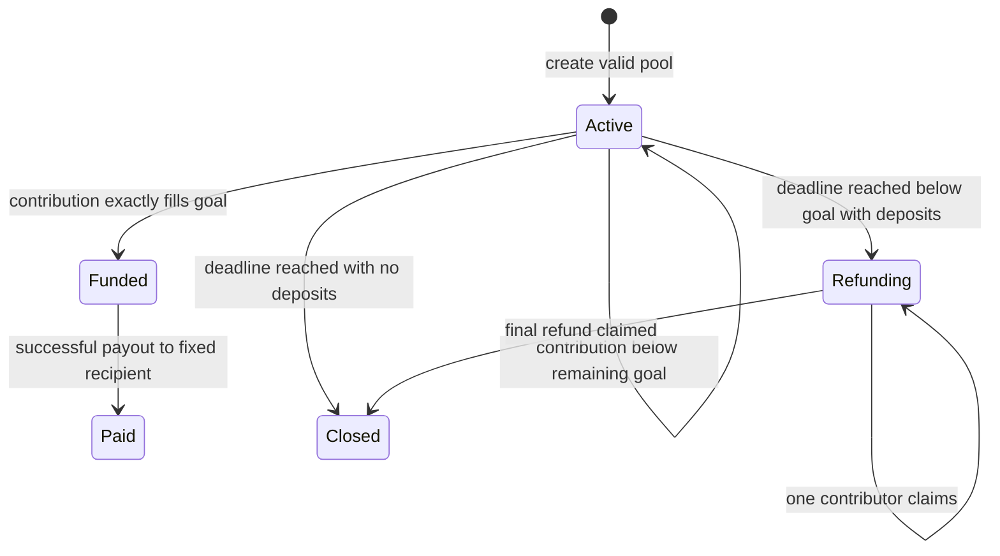

# HuiPot Goal Pool — Product specification

> **UI redesign amendment, October 24, 2026:** the user authorized reorganizing the interface around a separate landing page. D1's screen scope is now five: Landing, Explore pools, Create, Pool, Proof. See [REDESIGN.md](REDESIGN.md). AC10 now applies to all five. The contract and D2–D8 financial rules remain unchanged. The implementation-status wording in the original Phase 2 text below is historical; current code/review status is recorded in LOG.md.

Date: October 24, 2026 (Asia/Ho_Chi_Minh). Version: Phase 2 v1, approved for milestone A; Arc evidence clarification added during GitHub handoff.
Status: the user selected HuiPot Goal Pool, reviewed the Phase 2 proposal, and requested a GitHub push and Studio prompt to proceed. Phase 3 contract/test generation is authorized through the documented handoff. Nothing is implemented, tested, or deployed yet.

## Product and audience

**One sentence:** a small group pools USDC for one shared expense; the fixed recipient can receive the money only after the target is fully funded, otherwise contributors can reclaim their deposits after the deadline.

The first audience is an online club or small team whose members already use USDC and know the intended recipient. Example: pooling a known workshop expense. Members need visible funding conditions without sending deposits to the organizer's personal wallet. The contract enforces the funding condition; it cannot guarantee that the workshop happens or that the recipient delivers anything.

HuiPot is a goal pool, not a rotating savings circle. The distinguishing product choices are a fixed recipient, an exact funding cap, explicit commitment terms, and a readable contribution/payout/refund record. Demand and willingness to use the product remain unvalidated.

## Scope and proposed decisions

| ID | Proposed decision | Consequence to approve |
| --- | --- | --- |
| D1 | One non-upgradeable `HuiPotGoalPool` contract supports multiple independent pools. Four screens: Home, Create, Pool, Proof. | No factory, backend custody, marketplace, or separate token contract. Test helpers are not production deployments. |
| D2 | Use Arc native USDC through payable value and native transfers. | No ERC-20 allowance or approval flow. Native amount encoding uses 18 decimals, subject to pre-build source verification. |
| D3 | Target, recipient, deadline, title, and purpose are fixed at creation. Funding is capped exactly at the target. | No editing terms, extending time, changing destination, or partial acceptance of an excessive contribution. |
| D4 | Reaching the target before the deadline immediately makes the full target payable. | Payout may happen before the deadline. There is no delivery approval, spending vote, or waiting period. |
| D5 | Anyone may trigger payout, but it always goes to the fixed recipient. | The creator cannot redirect money; a missing creator does not prevent payout. The caller pays the transaction fee. |
| D6 | If the target is not met when the deadline arrives, each contributor may claim their own full principal. | Refunds are individual transactions, not automatic transfers. Gas is not refunded. No contributor list loop is needed. |
| D7 | Contributions cannot be withdrawn early; there is no cancellation or refund after successful funding. | Contributors commit until failure or success. A successful payout cannot be recalled. |
| D8 | No platform fee, administrator withdrawal, upgrade, pause, rescue/sweep, yield, or refund expiry. | No privileged recovery if a wallet is lost or a recipient rejects native transfers. These limitations must be visible before funding. |

These are internal product decisions, approved for milestone A through the GitHub handoff request, not competition requirements. See [REQUIREMENTS.md](REQUIREMENTS.md) for the supplied rules and their verification limits.

## Golden flow

1. An organizer connects a supported wallet on the selected validated network and creates a pool with title, purpose, target, deadline, and a fixed recipient.
2. A member opens the pool link, reviews the recipient and commitment terms, contributes, and sees a confirmed deposit after receipt validation.
3. A second contribution reaches the exact target. The pool becomes Funded; further contributions fail.
4. A wallet triggers payout. The full target goes to the fixed recipient. The pool becomes Paid only after successful execution is confirmed.
5. The Proof screen connects the pool terms, contribution receipts, payout event, and available native-value transfer evidence.

Local/testnet fixture only: target 1 USDC, contributions 0.4 and 0.6 USDC, then payout of 1 USDC. These numbers are not a mainnet budget or permission to spend. Also validate a separate failed-pool fixture with a 0.4 USDC deposit, expired deadline, and 0.4 USDC refund. The latter is a required recovery scenario, not a second product flow.

## Actors and permissions

| Actor | Permitted behavior | Boundaries |
| --- | --- | --- |
| Creator | Create a pool; contribute, claim their own failed-pool deposit, or trigger payout under the same rules as other wallets. | Creator identity is attribution, not admin authority. Cannot edit, cancel, extract, or approve spending. |
| Contributor | Make repeated contributions while Active; inspect cumulative deposits; claim their own refund if the pool failed. | No early exit, delegation, beneficiary replacement, or claim of another wallet's deposit. |
| Recipient | Receive the full target on successful payout; may also be creator or contributor. | Being recipient does not allow early or partial withdrawal. |
| Any caller | Read pool state and trigger a valid payout to the fixed recipient. | Cannot select a payout destination or amount. |
| Application | Read chain state, construct requests, ask the connected wallet to sign, and verify receipts. | Holds no user key and signs no transaction on the user's behalf. |

All deposits and pool metadata are public. Do not put personal details, secrets, or sensitive group membership information in pool text.

## Pool data and conceptual interface

This is an interface specification, not generated source or a promised ABI. Studio must export the actual ABI and keep the app aligned with it.

- IDs start at 1, increase monotonically, and are scoped to chain ID plus deployment address. Reject unknown IDs consistently, including reads.
- Store creator, fixed recipient, target, deadline (Unix seconds), title, purpose, cumulative contributions, cumulative refunds, and whether payout has completed. Per pool/wallet, retain cumulative contributed principal and refunded principal so history survives a refund.
- Target must be positive. Recipient must be a valid nonzero address different from this pool contract. Creator may equal recipient. The contract does not certify recipient ownership or native-transfer compatibility.
- Title: 1–80 UTF-8 bytes; purpose: 1–280 UTF-8 bytes. UI trims and rejects blank-only values before signing; contract enforces byte bounds. Render as escaped plain text. Do not add a metadata hosting dependency.
- Deadline must be strictly after the creation block timestamp and at most 30 days later. This duration cap is a product preference. Show the exact deadline and time zone before signature; a transaction delayed past the chosen time may revert.
- `createPool`: accepts fixed terms; nonpayable; creates only a pool record. No deposit is bundled into creation.
- `contribute(poolId)`: payable; credits only `msg.sender` using `msg.value`; no separate amount or beneficiary argument. Reject zero, invalid precision, non-Active state, and amounts above remaining capacity.
- `payout(poolId)`: nonpayable; sends exactly the target to the stored recipient once. Any caller may invoke it only when Funded.
- `claimRefund(poolId)`: nonpayable; sends the caller's full outstanding principal to the caller once, only when refund-eligible. No amount or alternative recipient argument.
- Read methods expose count, immutable terms, totals, derived status, and a wallet's contributed/refunded/claimable amounts. Refund-claimable must be zero until failure, even if that wallet has deposits.
- Reject ordinary direct native transfers and unknown payable calls. No onchain enumeration of all contributors and no mass payout/refund function.

Studio may propose naming or framework adjustments. Changes to money behavior, scope, deadlines, or permissions return to review before generation proceeds.

## Units and accounting

The prior official documentation snapshot in [ARC_TOOLING.md](ARC_TOOLING.md) reports 18 decimals for native USDC and 6 for its ERC-20 view of the same balance. For this product, **all contract amounts are native base units**. Never decode native value using 6 decimals or treat the two views as two assets.

Product amounts allow up to 6 decimal places: one contribution quantum is `10^12` native base units, or `0.000001 USDC`. Both targets and deposits must be positive multiples of that quantum. `1 USDC = 10^18` native base units. This precision restriction is a proposed product rule, not a network restriction. Gas estimates may have finer precision and must not be rounded to a misleading zero.

Parse decimal strings using integer arithmetic. Reject negative, exponent, comma, malformed, excessive-precision, and out-of-range input; never round a requested deposit or use floating point. Display principal with up to 6 decimals and explicit `USDC`; provide full precision for gas details where needed.

For every pool:

- `0 <= totalContributed <= target`.
- Sum of each wallet's cumulative contributions equals `totalContributed`.
- `0 <= totalRefunded <= totalContributed`; each wallet's refund is at most its own contribution, and their sum equals `totalRefunded`.
- `paidAmount` is either zero or exactly `target`. Payout and refunds are mutually exclusive.
- Outstanding liability equals `totalContributed - totalRefunded - paidAmount` and is never negative.
- Contract balance must be at least the sum of all pool liabilities. Use this as an invariant in tests; do not iterate all pools in a user transaction.

Pool accounting, never raw contract balance, determines whether a goal is met or how much can be paid/refunded. Forced or unsolicited balances must not credit any pool or be allocated to its users. Such surplus may remain inaccessible because there is no sweep function. Gas is paid by the transaction sender from their wallet, outside pool principal. A full refund means full deposited principal, not reimbursement of any fees.

## State machine and time boundaries

Use chain time. A client countdown is advisory and cannot authorize a transaction. Derive the state from stored totals, payout status, and the current block timestamp; an uncalled finalization function must never block a refund.

| State | Definition | Allowed money action |
| --- | --- | --- |
| Active | Not paid; contributed below target; chain time strictly before deadline. | Contribute an exact valid amount no larger than remaining capacity. |
| Funded | Target reached through contributions accepted before deadline; not paid. | Any caller may trigger full payout. It stays Funded after the deadline until payout succeeds. |
| Paid | Payout executed successfully. | None. Terminal. |
| Refunding | Below target; chain time at or after deadline; some principal remains unrefunded. | Each contributor claims their own entire outstanding deposit. |
| Closed | Below target; at or after deadline; all principal refunded, including a pool with no deposits. | None. Terminal. UI says “Closed — all refunds claimed” or “Closed — no contributions” as applicable. |

At `timestamp == deadline`, new contributions revert and an underfunded pool becomes refundable. A full pool never becomes refundable merely because time passes. There is no cancellation, unlock timer for successful pools, or automatic transaction triggered by time. Concurrent attempts to fill the last capacity are resolved by chain order; an excessive later contribution fully reverts and its caller can still incur gas.

## External calls, failure behavior, and events

- Only payout and refund transfer native value externally. Use checks, state updates, then the external call, plus an established reentrancy guard. Guard all money-mutating entry points against cross-function and cross-pool reentry; justify the chosen dependency and pin its version.
- If the receiver rejects the transfer or the call fails, revert the entire transaction: no liability decrement, success flag, or success event survives. A later retry sends to the same fixed destination.
- Do not use a fixed 2,300-gas transfer stipend, silently ignore call failure, perform external calls during contribution, or introduce arbitrary-call execution.
- A rejecting recipient can leave a funded pool stuck; a rejecting contributor wallet can leave its refund stuck. Lost keys may prevent recovery. The initial demonstration must use human-controlled wallets with validated native receipt support. Changing a destination after deposits is deliberately unavailable; it must not appear as a recovery promise.
- There is no offchain oracle, trusted scheduler, service signer, token approval, or interaction with a yield/bridge protocol.

Required semantic events (final ABI comes from Studio):

| Event | Required facts |
| --- | --- |
| PoolCreated | Pool ID, creator, recipient, target, deadline, and terms available through readable storage. |
| Contributed | Pool ID, contributor, this amount, new contributed total. |
| GoalReached | Pool ID and target, once, in the contribution transaction reaching the cap. |
| PaidOut | Pool ID, caller, fixed recipient, exact amount, once after successful transfer. |
| Refunded | Pool ID, contributor/recipient, exact refunded amount. |

Index pool ID and relevant addresses within EVM topic limits. Events must agree with storage and receipts. No fabricated expiry event is required: time passes without a transaction. Reads determine deadline status.

## Acceptance criteria and test matrix

Everything below is **planned; no tests have run**. Studio writes the tests, executes and reviews them, and exports raw evidence. Codex independently reviews and runs applicable exported checks in later phases. Table rows are test groups, not a claim about test counts.

| ID | Acceptance criterion / cases | Required validation |
| --- | --- | --- |
| AC01 | Valid creation; immutable terms; independent IDs; creator/recipient may match; invalid recipient/self, zero/precision-invalid target, invalid text byte lengths, unknown IDs, deadline now/past/>30 days, and nonpayable value revert. | Contract tests, including exactly 30 days and UTF-8 boundaries; ABI review for absent privileged setters. |
| AC02 | Multiple wallets and repeated contributions accumulate correctly; zero, sub-quantum, excessive, post-goal, and expired deposits revert without partial credit; exact remaining amount succeeds. | Contract tests at minimum quantum, large valid integer amounts, and concurrent-fill ordering. |
| AC03 | Funding just before deadline succeeds; at/after deadline fails; underfunded refunds open exactly at deadline; completed goal stays Funded after deadline. | Controlled block-time boundary tests; no wall-clock sleep. |
| AC04 | Any caller can pay exactly the target only to the fixed recipient; early payout, repeated payout, and every post-payout money action fail. | Balance deltas, status and event assertions; account separately for gas when caller equals recipient. |
| AC05 | Underfunded contributor recovers their entire cumulative principal once; other wallets cannot take it; no claim before expiry or after goal; final refund closes the pool; zero-deposit expired pool closes without a transaction. | Multi-wallet refund tests, repeated/unauthorized claims, delayed claims without expiry. |
| AC06 | One pool cannot consume another's deposits. Cumulative contribution, refund, paid amount, and aggregate liability invariants hold across valid/invalid action sequences. | Stateful or fuzz tests over multiple pools/wallets, retained reproducible seeds, forced-balance test with invariant `balance >= liabilities`. |
| AC07 | Rejecting/reentering recipients cannot steal or erase claims, including cross-pool calls. Failed external calls leave all state and events unchanged. | Studio-generated adversarial receiver helpers and retry tests for both payout and refund. |
| AC08 | Events report actual terms, sender, amounts, target transition, payout, and refunds; no success event for reverted actions. | Event/storage/receipt assertions; multiple contributions trigger GoalReached exactly once. |
| AC09 | Native 18-decimal encoding with 6-decimal product input is consistent end to end; fee display preserves smaller values; no ERC-20 approval. | Contract amount tests plus app parsing/formatting cases for 0.000001, 0.4, 0.6, 1, excessive precision, unsafe large values, exponent notation, and malformed strings. |
| AC10 | All four screens work at 390px and 1440px with keyboard/labels/focus/contrast; mock data is labeled; missing proof has an honest empty state. | App checks and actual screenshots against [DESIGN.md](DESIGN.md); manual gaps listed explicitly. |
| AC11 | Wallet connection, network mismatch, insufficient principal plus gas, stale chain state, signature rejection, pending/replaced/reverted transaction, RPC failure, and account/network changes have clear recoverable states. | Studio app tests and browser checklist; invalidate stale requests after wallet changes. |
| AC12 | Local and then supported-testnet golden flow and failed-pool refund use the reviewed contract/ABI; UI success follows receipt status and expected contract events/state. | Recorded flow, exact chain/deployment, receipts and balances; distinguish local/testnet from mainnet. |
| AC13 | Proof binds chain, deployment, pool, receipt status, expected event, and native movement; unsupported or incomplete evidence is labeled; mock/testnet results cannot earn a mainnet badge. | Wrong-chain/address/pool/hash, pending/reverted receipt, absent event, native-transfer evidence unavailable, and RPC-failure cases. |

## Network and evidence assumptions

The following is a prior directly checked documentation/RPC snapshot from October 24, 2026, recorded in [ARC_TOOLING.md](ARC_TOOLING.md). Phase 2 does not claim a fresh connectivity or wallet test:

| Intended environment | Chain ID | RPC | Explorer |
| --- | --- | --- | --- |
| Arc testnet | 5042002 | `https://rpc.testnet.arc.io` | `https://explorer.testnet.arc.io` |
| Arc mainnet | 5042 | `https://rpc.mainnet.arc.io` | `https://explorer.arc.io` |

Source references: [connection details](https://docs.arc.io/arc/references/connect-to-arc.md), [EVM differences](https://docs.arc.io/arc/references/evm-differences.md), [Studio overview](https://docs.arc.io/ai/arc-studio.md). Confirm current source content and the native-unit model before Studio generation; resolve any conflict rather than copying a generic Ethereum template. No token address is required for the proposed native-only path.

Validate locally, then on the officially supported testnet. Faucet availability, selected wallet behavior, actual deployment/export controls, and any Studio automatic testnet deployment must be checked before that operation. No faucet URL, wallet compatibility, public hosting URL, deployment address, or block number is invented here. Studio's documented deployment is testnet-only; mainnet uses a later, separately approved human-signature plan tied to reviewed artifacts.

Each deployment configuration must contain the verified chain, RPC, explorer, contract address, deployment block, ABI/source revision, and validation status. An absent or inconsistent configuration disables live transactions. Local/mock mode must be explicit. No default mainnet write configuration.

For contributions, verify the successful receipt, destination contract, native transaction value, decoded contribution event, and intended pool. For payouts/refunds, the outer transaction can have zero value: check the successful receipt and expected contract event/state plus independently available native transfer trace/explorer evidence or suitable same-block balance evidence. An event alone must not be described as independently inspected recipient receipt. If movement evidence is unavailable, label that limitation and leave mainnet proof incomplete. Separate evidence that a transaction happened from evidence that the human initiated it through the app; the latter needs actual flow capture.

GitHub handoff verification, October 24: current official [native model](https://docs.arc.io/arc/concepts/stablecoin-native-model.md) confirms 18 native decimals and 6 ERC-20 decimals for the same balance. Current [system-event documentation](https://docs.arc.io/arc/references/usdc-system-events.md) provides an additional native-movement evidence path: match the successful transaction's system-emitted Transfer log, its verified emitter, from/to, and 18-decimal amount to the intended pool action. This protocol log is distinct from HuiPot's own event and the ERC-20 interface's 6-decimal event. Do not double-count the two streams or substitute an app event for the protocol log. See the latest ARC_TOOLING.md note for emitter and source details.

The [EVM reference](https://docs.arc.io/arc/references/evm-differences.md) also documents runtime blocklist/value-transfer restrictions and different local simulation behavior. Native transfers may fail despite sufficient balance. Ordinary EVM tests do not prove Arc-specific execution; identify the actual Studio test runtime, use supported Arc simulation/integration when available, and disclose gaps. This clarification changes verification requirements, not D1-D8 money behavior.

## Excluded features and residual risks

Exclude voting, delivery verification, dispute resolution, milestones, recurring/rotating payouts, loans, interest, investments, changing recipients, partial payouts, early cancellation, early withdrawal, sponsored gas, fiat onboarding, bridges, admin rescue, unlimited approvals, and a global indexed marketplace. Home lists only a bounded recent set from the configured deployment and provides pool-ID lookup; it does not claim to index every pool or wallet history.

Shared custody is unaudited. Valid payout does not establish delivery. Funds may be locked until the deadline, and successful funding removes the refund route immediately. Lost wallets or incompatible receivers have no privileged recovery. RPC/indexing failure may hide data without changing onchain rights. Failed or excessive contributions can cost gas. Source changes require renewed validation. Stop mainnet planning for unresolved critical fund-loss risks.

## Phase 2 gate and handoff

The user authorized proceeding with D1–D8, the four-screen [design](DESIGN.md), and milestone A through the GitHub handoff request after the Phase 2 review. Money behavior remains immediate payout after the exact goal, immutable destination, no early withdrawal/cancellation, and contributor-claimed refunds only after failed expiry.

The current authorized phase is Phase 3: Studio contract/test generation and review using milestone A. Milestones B–D remain behind the Phase 3 gate for app work. The user explicitly authorized the prepared documentation push to the existing GitHub repository; public app publication and mainnet spending remain separate. See [STUDIO_GITHUB_START.md](STUDIO_GITHUB_START.md) for the repo-based prompt and [STUDIO_HANDOFF.md](STUDIO_HANDOFF.md) for exports/evidence.
